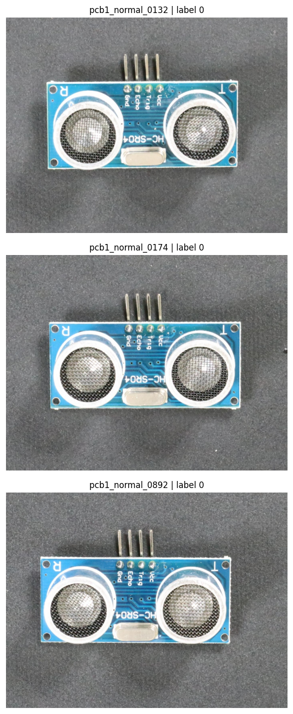
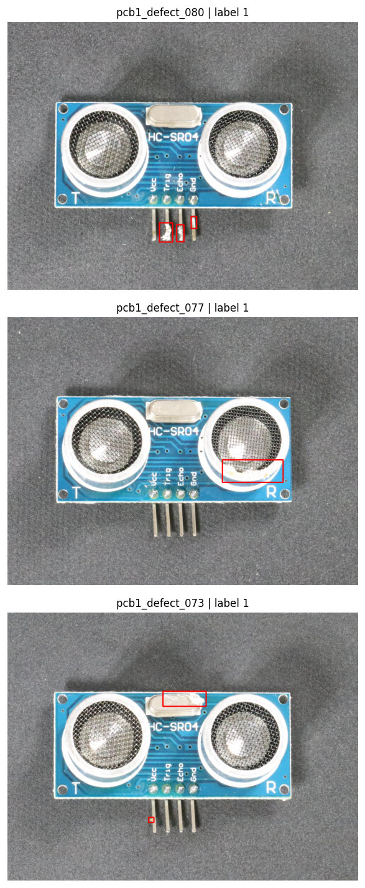

# Vision Model Selection Benchmark

A practical, reproducible benchmark that answers one question: **when should a company use YOLO, a Vision Transformer, an open-source VLM, a cloud vision model, or a private/local model?**

The same task, split, preprocessing and metrics are applied to every model type across three enterprise scenarios (manufacturing, documents, retail). The output is a decision framework, not a leaderboard.

> Status: Phase 1 in progress. Manufacturing data (VisA `pcb1`) prepared and explored; data fixes and models are next. See [docs/CHECKLIST.md](docs/CHECKLIST.md).

Built as part of a remote internship at GenAI Protos. Author: Abdullah Bakr.

## What is measured

Eight dimensions per model: task quality (accuracy, precision, recall, F1), latency, GPU memory, model size, false positives, false negatives, cost per 1,000 images, and explainability. For VLMs, JSON parse failures are reported as a result in their own right.

## Scenarios

| Scenario | Dataset | Task | Status |
|---|---|---|---|
| Manufacturing defect detection | VisA (`pcb1` first) | image-level normal / defective | Phase 1 |
| Document understanding | to be selected | field extraction or QA | Phase 3 |
| Retail / product recognition | to be selected | classification or counting | Phase 3 |

## Model families

YOLO (detection), Vision Transformer / Swin (classifier), open-source VLM, Gemma-family multimodal model, cloud-hosted vision model, local/private model. Choices and rationale: [docs/model-selection.md](docs/model-selection.md).

## Early findings: manufacturing data (VisA pcb1)

Found during EDA, before any model was trained ([notebook](notebooks/manufacturing/01_eda.ipynb)).

**Board orientation leaks the label.** In the raw data 439 of 550 normal boards are rotated 180 degrees, while 96 of 100 defective boards are upright. A trained model could reach a high score by learning orientation instead of defects. Data prep rotates every board upright before any model sees it.

| Normal boards (mostly rotated 180) | Defective boards (almost all upright) |
|---|---|
|  |  |

**Defects are small.** The median defect covers 0.2% of the image, and 23 of 100 defective images contain a box under 32 x 32 pixels (bent or solder-blobbed pins, small scratches). Resizing to a typical classifier input of 224 px shrinks many of them to a few pixels, so input resolution is measured as a variable.

**Color adds little.** For 92% of defects the brightness difference to the surroundings is larger than the color difference, so defects stay visible in grayscale.


## Repository layout

```
.
├── README.md
├── LICENSE                  Apache-2.0 (code only)
├── requirements.txt
├── configs/                 benchmark settings (seed, split sizes, thresholds)
├── datasets/                one folder per scenario: README + preparation script
│   ├── manufacturing_visa/
│   ├── documents/
│   └── retail/
├── pyproject.toml           makes src/vision_benchmark installable (pip install -e .)
├── src/vision_benchmark/    reusable code
│   ├── data/                dataset checks (board orientation, defect contrast)
│   ├── models/              one wrapper per model, same interface
│   ├── evaluation/          metrics, timing, memory, cost
│   └── utils/               box helpers, plotting
├── notebooks/               EDA, data prep and model runners (Kaggle / local)
├── scripts/                 command-line entry points
├── results/                 per-image logs, result tables, figures
├── demo/                    upload-and-compare demo app
└── docs/                    methodology, findings, decision framework, blog, posts, diagrams
```

## Getting started

Data is never stored in the repo; each `datasets/*/README.md` explains how to get it. Full setup (pinned requirements, Kaggle steps) is added once the Phase 1 pipeline runs end to end.

Current steps for the manufacturing data:

```
git clone https://github.com/abdubakr77/vision-model-selection-benchmark.git
cd vision-model-selection-benchmark
pip install -e .                      # installs the helpers in src/ for the notebooks
python datasets/manufacturing_visa/prepare_data.py datasets/manufacturing_visa bench
```

Then open `notebooks/manufacturing/01_eda.ipynb`. See [datasets/manufacturing_visa/README.md](datasets/manufacturing_visa/README.md) for where the VisA files go.

## Licenses and attribution

- Code in this repo: Apache-2.0.
- VisA dataset: CC BY 4.0 according to its authors (confirm before publishing). Cite Zou et al., "SPot-the-Difference Self-Supervised Pre-training for Anomaly Detection and Segmentation", ECCV 2022.
- Ultralytics YOLO is AGPL-3.0 (an enterprise license exists). Review before using it in client work.
- Gemma models are under Google's Gemma terms and must be accepted by each user on Hugging Face.
