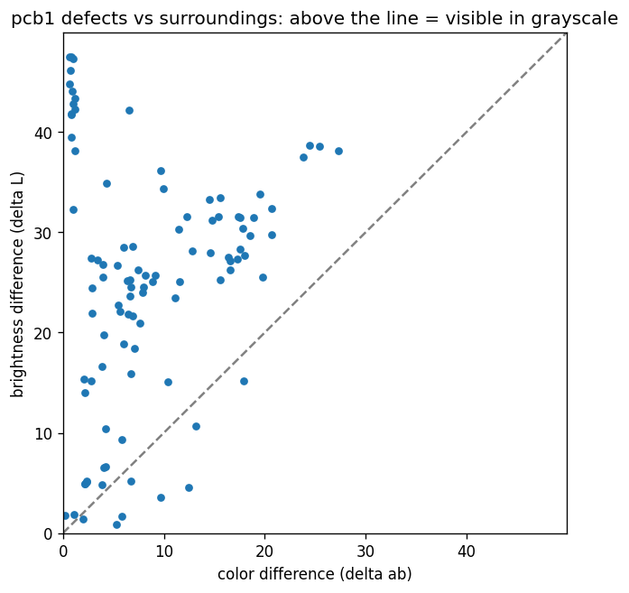
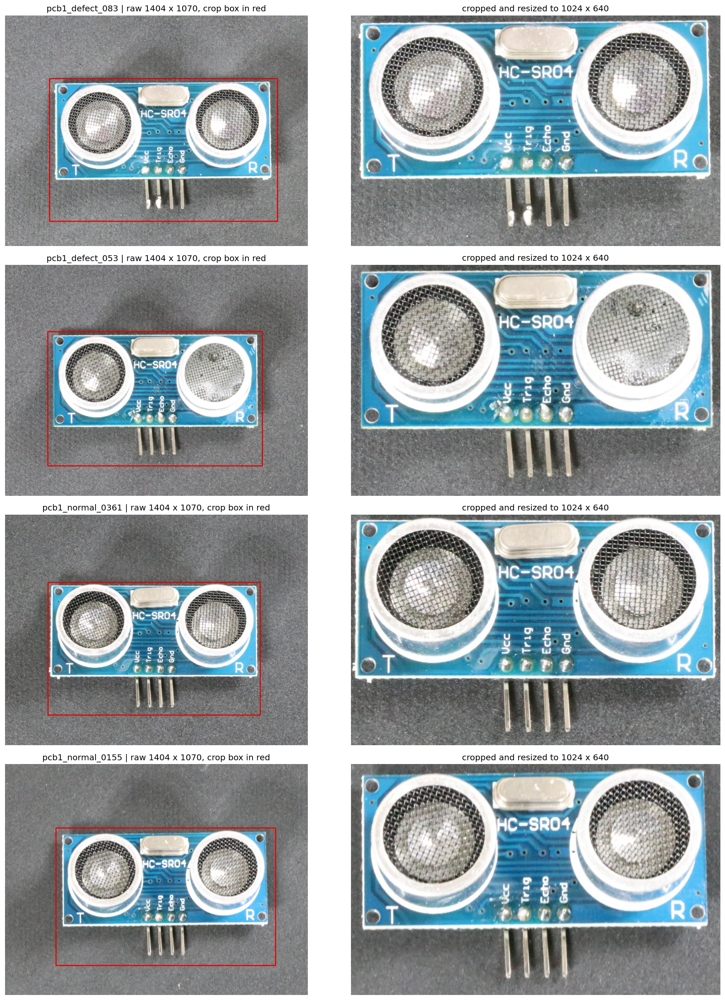

# Vision Model Selection Benchmark

A practical, reproducible benchmark that answers one question: **when should a company use YOLO, a Vision Transformer, an open-source VLM, a cloud vision model, or a private/local model?**

The same task, split, preprocessing and metrics are applied to every model type across three enterprise scenarios (manufacturing, documents, retail). The output is a decision framework, not a leaderboard.

> Status: Phase 1 in progress. Manufacturing data (VisA `pcb1`) explored and prepared (orientation fixed, board crop, stratified split, gray and color copies, train-only augmentation). YOLO is trained on gray and on color; Swin/ViT and a small open VLM are next. See [docs/CHECKLIST.md](docs/CHECKLIST.md).

Built as part of a remote internship at GenAI Protos. Author: Abdullah Bakr.

## What is measured

Eight dimensions per model: task quality (accuracy, precision, recall, F1), latency, GPU memory, model size, false positives, false negatives, cost per 1,000 images, and explainability. For VLMs, JSON parse failures are reported as a result in their own right.

## Scenarios

| Scenario | Dataset | Task | Status |
|---|---|---|---|
| Manufacturing defect detection | VisA (`pcb1` first) | image-level normal / defective | Phase 1 |
| Document understanding | to be selected | field extraction or QA | Phase 3 |
| Retail / product recognition | to be selected | classification or counting | Phase 3 |

## Model families

YOLO (detection), Vision Transformer / Swin (classifier), open-source VLM, Gemma-family multimodal model, cloud-hosted vision model, local/private model. Choices and rationale: [docs/model-selection.md](docs/model-selection.md).

## Early findings: manufacturing data (VisA pcb1)

Found during EDA on the raw data, before any model was trained ([notebook](notebooks/manufacturing/01_eda.ipynb)).

**Board orientation leaks the label.** In the raw data 790 of 1004 normal boards are rotated 180 degrees, while 96 of 100 defective boards are upright. A trained model could reach a high score by learning orientation instead of defects. Data prep ([notebook](notebooks/manufacturing/02_data_prep.ipynb)) turns every used board upright before any model sees it.

| Normal boards (mostly rotated 180) | Defective boards (almost all upright) |
|---|---|
|  |  |

**Defects are small.** The median defect covers 0.2% of the image, and about a quarter of the defective images contain a box under 32 x 32 pixels at 1024 px wide, all of them solder blobs (`melt`). Resizing to a typical classifier input of 224 px shrinks many of them to a few pixels, so input resolution is measured as a variable, and the split is stratified so val and test hold a fair share of small defects.

**Color adds little.** For 93% of defects the brightness difference to the surroundings is larger than the color difference, so defects stay visible in grayscale.



**Every board is cropped the same way.** Data prep cuts each image to the board (small margin, room below for the pins) at full resolution before resizing to 1024 x 640, so defects get about 1.4x more pixels. The rule uses no labels, so any new image gets the same crop, and no defect pixel is cut off.



## First results: YOLO26-S on pcb1

Image-level results on the 330 test images (30 defective, 300 normal), threshold chosen on val ([notebook](notebooks/manufacturing/03_yolo.ipynb)):

| Run | Defects found | False alarms | AUROC | AP | F1 |
|---|---|---|---|---|---|
| gray | 25 / 30 | 8 / 300 | 0.912 | 0.823 | 0.794 |
| color | 26 / 30 | 6 / 300 | 0.946 | 0.883 | 0.839 |

Color is slightly better on test, but one image is 3.3 points of recall, so the gap is small. Both runs miss mostly solder blobs (`melt`); missing, bent and scratched pins are all found.

## Repository layout

```
.
├── README.md
├── LICENSE                  Apache-2.0 (code only)
├── requirements.txt
├── configs/                 one yaml per model run (training settings)
├── datasets/                one folder per scenario: README with source, license and data layout
│   ├── manufacturing_visa/
│   ├── documents/
│   └── retail/
├── pyproject.toml           makes src/vision_benchmark installable (pip install -e .)
├── src/vision_benchmark/    reusable code
│   ├── data/                raw loading, orientation, board crop, split, augmentation, writing bench/
│   ├── models/              one wrapper per model (YOLO predictions per image)
│   ├── evaluation/          image-level metrics, detection summary
│   └── utils/               box helpers, plotting
├── notebooks/               one folder per scenario, every notebook of that dataset
│   ├── manufacturing/       01_eda, 02_data_prep, 03_yolo ... 08_results
│   ├── documents/
│   └── retail/
├── scripts/                 command-line entry points
├── results/                 run folders per model and dataset (yolo/pcb1/...), figures, tables
├── demo/                    upload-and-compare demo app
└── docs/                    methodology, findings, decision framework, blog, posts, diagrams
```

## Getting started

Data is never stored in the repo; each `datasets/*/README.md` explains how to get it. Full setup (pinned requirements, Kaggle steps) is added once the Phase 1 pipeline runs end to end.

Current steps for the manufacturing data:

```
git clone https://github.com/abdubakr77/vision-model-selection-benchmark.git
cd vision-model-selection-benchmark
pip install -e .                      # installs the helpers in src/ for the notebooks
```

1. Put the VisA files in place as described in [datasets/manufacturing_visa/README.md](datasets/manufacturing_visa/README.md).
2. Run `notebooks/manufacturing/01_eda.ipynb` to explore the raw data.
3. Run `notebooks/manufacturing/02_data_prep.ipynb` to build `bench/` (about 1 minute).
4. Train YOLO with `notebooks/manufacturing/03_yolo.ipynb` (settings in `configs/yolo26s.yaml`). The runs here trained on Kaggle (T4 x2); the notebook then reads the run folders in `results/yolo/pcb1/`.

## Licenses and attribution

- Code in this repo: Apache-2.0.
- VisA dataset: CC BY 4.0 according to its authors (confirm before publishing). Cite Zou et al., "SPot-the-Difference Self-Supervised Pre-training for Anomaly Detection and Segmentation", ECCV 2022.
- Ultralytics YOLO is AGPL-3.0 (an enterprise license exists). Review before using it in client work.
- Gemma models are under Google's Gemma terms and must be accepted by each user on Hugging Face.
